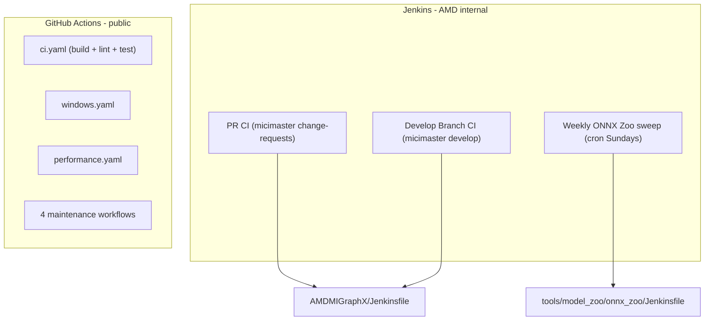

# Level 1 - Map the Ecosystem (what exists and where)

Goal: see the whole CI landscape for AMDMIGraphX and answer the team's open
question - *"where are the Jenkinsfiles for the other jobs?"*

## Big idea: there are TWO independent CI systems

1. **Jenkins** - AMD-internal server (`micimaster.amd.com`). This is your
   team's main responsibility.
2. **GitHub Actions** - public, defined in `.github/workflows/` and run by
   GitHub itself. Secondary context, but it *is* part of "the CIs."

They do overlapping work (both build+test MIGraphX) but are configured in
completely different files and run on different machines.

## The repo contains exactly TWO Jenkinsfiles

Confirmed by searching the tree:

- `AMDMIGraphX/Jenkinsfile` - the per-commit / per-PR **gate** (Level 2).
- `AMDMIGraphX/tools/model_zoo/onnx_zoo/Jenkinsfile` - the weekly ONNX model-zoo
  **tracker** (Level 3).

There is **no third Jenkinsfile in this repo** - these two cover everything we
build here.

## Mapping the Jenkins jobs

| Job | URL | Backed by |
|---|---|---|
| PR CI | `micimaster.amd.com/job/AMDMIGraphX/view/change-requests/` | `AMDMIGraphX/Jenkinsfile` (runs on each PR) |
| Develop Branch CI | `micimaster.amd.com/job/AMDMIGraphX-develop/job/develop/` | `AMDMIGraphX/Jenkinsfile` (runs on the `develop` branch) |

Why PR CI and Develop CI are the *same* file: the root `Jenkinsfile` is
triggered by SCM (code changes) and uses `env.BRANCH_NAME` to decide small
differences. **`env.BRANCH_NAME` is a variable Jenkins fills in automatically
with the name of the branch currently being built** (e.g. a PR's branch,
`develop`, or `master`). The pipeline reads that name to change its own behavior
per branch - for example it only archives the built `.deb` when the branch is
`develop`/`master` (see `AMDMIGraphX/Jenkinsfile` ~line 110). So a PR build and a
develop build are the same pipeline pointed at different branches.

The weekly sweep (`onnx_zoo/Jenkinsfile`) is a separate Jenkins job triggered by
`cron` (Sundays), not by PRs.

## What is GitHub Actions (and a "workflow")?

**GitHub Actions** is a CI system built into GitHub itself - the same idea as
Jenkins, but you don't run your own servers; GitHub provides the machines
("runners") and runs jobs automatically when something happens in the repo (a
push, a PR, or a schedule).

A **workflow** is GitHub Actions' version of a pipeline: a single `.yaml` file
under `.github/workflows/` that says *what to run* and *when*. Each workflow has
**jobs** (run in parallel by default), and each job has **steps** (run in order).
Mapping to the Jenkins words you already learned:

- workflow file (`.yaml`) is like a Jenkinsfile (the whole pipeline)
- job is like a stage
- step is like one command inside a stage
- runner is like a node/agent (here provided by GitHub, not AMD)

The trigger sits at the top of each file under `on:` (e.g. `on: pull_request`, or
a `schedule:` with a cron). That is literally how GitHub knows when to run it.

## The GitHub Actions side (`.github/workflows/`)

Seven workflow files (characterized at Level 5):

- `ci.yaml` - the main public CI: checks/builds Docker images (Ubuntu + SLES),
  then runs lint/static-analysis/build/test jobs (`tidy`, `cppcheck`, `format`,
  `pyflakes`, `licensing`, `linux`, `misspell`, `sles`).
- `windows.yaml` - Windows CPU build (Release + Debug).
- `performance.yaml` - scheduled performance tests (weekdays 07:00) +
  manual trigger.
- `weekly_master_sync.yaml` - Sunday job that syncs `master` and merges `develop`.
- `sync-onnxrt-main.yaml` - Friday job that opens a PR pinning a new onnxruntime
  commit.
- `clean-closed-pr-caches.yaml` - deletes CI caches when a PR is closed.
- `pr-review-status.yaml` - publishes a PR-review dashboard (GitHub Pages).

## Direct answer to the team's question

> "Where can we find the Jenkinsfiles?"

- **PR CI** and **Develop Branch CI** use the **same** file,
  `AMDMIGraphX/Jenkinsfile` - there is no separate file per job; they are one
  pipeline pointed at different branches.
- The **weekly ONNX Zoo sweep** uses
  `AMDMIGraphX/tools/model_zoo/onnx_zoo/Jenkinsfile`.

## Open questions to confirm with the team

1. Confirm PR CI and Develop CI both point at the root `Jenkinsfile`.
2. Is the weekly `onnx_zoo` sweep the same job as "Develop Branch CI," or a
   separate job on the develop branch? (The email phrasing conflated them.)
3. Who owns the **GitHub Actions** workflows vs the **Jenkins** jobs?

> Deliverable done when: you can draw the diagram from memory and state which
> file backs each Jenkins job.
