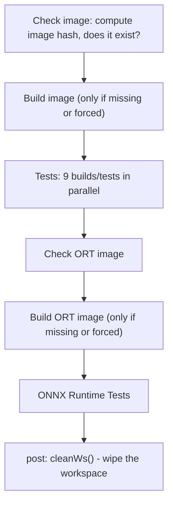

# Level 2 - The PR/Develop "Gate" (root `Jenkinsfile`), high level

File: `AMDMIGraphX/Jenkinsfile`

Goal: understand **what** the gate does and its stage order. We are NOT reading
the Groovy helper functions yet (that's Level 4) - only the `pipeline { stages { ... } }`
near the bottom of the file.

## What "gate" means here

On every PR and on pushes to `develop`/`master`, this pipeline builds MIGraphX
many different ways **in parallel**, each on a machine that matches the needed
GPU, and runs its tests. If any build/test fails, the PR's GitHub checks go red
and **merging is blocked**. That is the "gate."

## Two Docker images drive it

- `rocm/migraphx-ci-jenkins-ubuntu` - the normal build/test image.
- `rocm/migraphx-ci-jenkins-ubuntu-ort` - same, plus an onnxruntime checkout at
  `/onnxruntime`, used only by the final ONNX Runtime stage.

## Stage order (top-level flow)

- `Check image` / `Build image` - lines ~313-357. See Level 4 for the clever
  "only rebuild when the environment changed" trick.
- `Tests` (parallel block) - lines ~361-501.
- `Check ORT image` / `Build ORT image` - lines ~503-546.
- `ONNX Runtime Tests` - lines ~548-569.
- `post { always { cleanWs() } }` - lines ~572-577.

Two pipeline parameters let you override behavior (lines ~307-310):
- `FORCE_DOCKER_IMAGE_BUILD` - rebuild images even if the hash already exists.
- `FORCE_REBUILD` - re-run stages even if GitHub already says they passed.

## The 9 parallel test stages (one line each)

Each stage picks a node with `rocmnodename(...)` and then calls `cmake_build`
with different flags. Source: `AMDMIGraphX/Jenkinsfile` lines ~363-500.

1. **All Targets Release** - node `mi300+`; release build with GPU + CPU + FPGA
   backends all enabled, compiled for every supported arch.
2. **Clang ASAN** - node `nogpu`; debug build with Address+Undefined sanitizers
   (`-fno-sanitize-recover`), CPU backend only, Python and C-API test off.
3. **Clang libstdc++ Debug** - node `nogpu`; debug build with UBSan plus
   `-D_GLIBCXX_DEBUG` (hardened libstdc++), no GPU/CPU backends.
4. **HIP Clang Release** - node `mi300+`; the canonical GPU release build.
   **Stashes** the resulting `.deb` as `migraphx-package` for the ORT stage.
5. **HIP Clang Static** - node `mi300+`; static libraries
   (`-DBUILD_SHARED_LIBS=Off`), no Python, skips packaging.
6. **HIP Clang Release Navi32** - node `gfx1101`; builds only Navi3x targets,
   ONNX tests disabled.
7. **HIP Clang Release Navi4x** - node `gfx1201`; builds only Navi4x targets,
   ONNX tests disabled.
8. **HIP RTC Debug** - node `mi300+`; runtime kernel compilation
   (`-DMIGRAPHX_USE_HIPRTC=On`), host-side UBSan, `MIGRAPHX_GPU_DEBUG=1`.
9. **MLIR Debug** - node `mi300+`; MLIR enabled (`-DMIGRAPHX_ENABLE_MLIR=On`)
   with a stage-level `environment` block turning on *every* MLIR fusion path to
   exercise the maximum offload surface (lines ~478-489).

## The final stage: ONNX Runtime Tests

Node `onnxrt`, using the ORT image. It **unstashes** the `.deb` built in stage 4,
installs it with `apt-get`, then runs `/onnxruntime/build_and_test_onnxrt.sh`.
This proves ORT's MIGraphX execution provider works against *this commit's*
package - not a previously released one. (Lines ~548-569.)

Dependency to remember: stage 4 (**HIP Clang Release**) produces the `.deb` that
this stage consumes. That link is enforced by `skip_also_requires` - explained
at Level 4.

## Beginner takeaways

- "Many builds at once, each on a matching GPU" = broad coverage, fast feedback.
- Debug/sanitizer builds (ASAN/UBSan/`_GLIBCXX_DEBUG`) catch memory and
  undefined-behavior bugs a normal release build would hide.
- Navi32/Navi4x stages exist because code must be validated on *each* GPU family.
- The ORT stage is an end-to-end integration check across another project.

## Check-your-understanding

1. Which single stage must NOT be skipped because a later stage needs its
   output, and why?
2. Why are there separate Navi32 and Navi4x stages instead of one GPU stage?
3. What does the `post { always { cleanWs() } }` block do, and why is it useful?

> Deliverable done when: you can name all 9 stages and say, in one line each,
> what each is checking.
