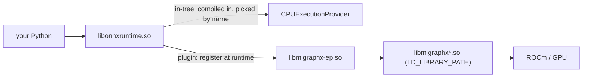

# 01. Two ways to attach an EP

ONNX Runtime does not run every operation itself. It groups operations and hands each group to a backend called an **execution provider (EP)**. The CPU EP runs them on the CPU. The MIGraphX EP sends a subgraph to MIGraphX, which compiles it into GPU kernels. This lecture is about how an EP gets attached to ORT in the first place, because that is the only real difference between in-tree and plugin.

## In-tree: compiled into ORT, picked by name

In the in-tree method the EP's **adapter** is compiled into ONNX Runtime's own `libonnxruntime.so`. You select it by naming it:

```python
ort.InferenceSession("model.onnx", providers=["CPUExecutionProvider"])
```

The name only resolves because that build of ORT already contains the adapter. No file is loaded at runtime, nothing is registered. `ort.get_available_providers()` lists it the moment you import ORT. This is exactly how ROCm 7.2 shipped the MIGraphX EP: `providers=["MIGraphXExecutionProvider"]` worked because the adapter was baked into that ORT build. Lecture 03 demonstrates this with the CPU EP (zero dependencies); lecture 06 does it with the real in-tree MIGraphX EP so you can compare it directly against the plugin.

## The thing people get wrong — answered

A common question: *"If the EP is compiled into ORT's own library, does that mean all of MIGraphX — compilation, kernel generation, everything — is inside ORT?"*

No. What is compiled into `libonnxruntime.so` is only the **adapter**: the glue that carves out a subgraph, calls `migraphx::parse`/`compile`/`run`, and copies tensors in and out. The actual MIGraphX compiler and kernel generator live in **separate shared libraries** — `libmigraphx.so`, `libmigraphx_gpu.so`, and friends (the `migraphx_libs` wheel here). Those are found at runtime through `LD_LIBRARY_PATH`. They are **never** inside ORT.

So "the EP is compiled into ORT" means "ORT knows how to talk to MIGraphX," exactly as you suspected. MIGraphX itself is always a separate set of `.so` files on the library path.

## Plugin: a separate .so, loaded at runtime

In the plugin method the adapter is pulled out of ORT into its own file, `libmigraphx-ep.so`. ORT does not contain it. Two calls attach it:

```python
ort.register_execution_provider_library("MIGraphXExecutionProvider", "/path/to/libmigraphx-ep.so")
# ... find the device this EP runs on, attach it to a SessionOptions
so.add_provider_for_devices([ep_device], {"device_id": "0"})   # option values must be strings
```

The plugin interface is an ABI — a fixed agreement between ORT and the `.so` (`OrtEpFactory`, `OrtEp`, `OrtNodeComputeInfo`, `OrtDataTransferImpl`). It was added in ONNX Runtime 1.24, so any ORT from 1.24 on can load a plugin EP built against it. This is how ROCm 10.1 ships the MIGraphX EP.

Note what did *not* change: the plugin `.so` still depends on the same external `libmigraphx*.so` on `LD_LIBRARY_PATH`. Pulling the adapter out of ORT did not pull MIGraphX in.

## The whole picture



Read it as three layers that never merge:

```
in-tree:   libonnxruntime.so [ORT core + CPU adapter]           -> (CPU needs no external libs)
plugin:    libonnxruntime.so [ORT core]  --load-->  libmigraphx-ep.so [MIGraphX adapter]  -->  libmigraphx*.so (LD_LIBRARY_PATH)
```

## Experiment: how ORT lists each kind

No venv yet. If you have the existing `JIRA/AIMIGRAPHX-1371/.venv` around, this one line shows the distinction already: in-tree EPs appear in `get_available_providers()`; a plugin appears only after you register it. You will do this properly in lectures 03-05. For now just hold the idea:

- In-tree EP: in `get_available_providers()` from the start.
- Plugin EP: absent there; shows up in `get_ep_devices()` only after `register_execution_provider_library`.

You can stop here.
