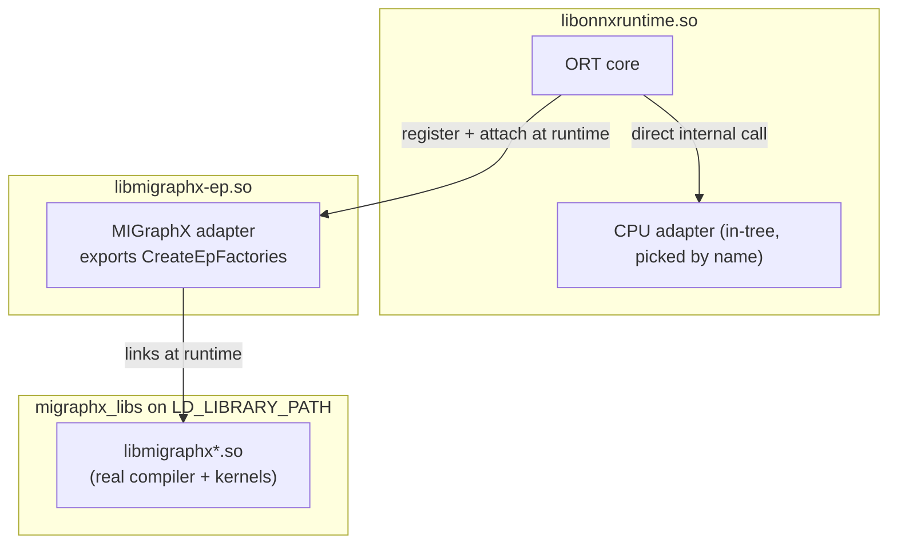

# 05. Analyze what comes in ORT

You ran the same model two ways. The in-tree CPU EP needed only a name; the MIGraphX plugin needed a library load plus a device attach. This lecture proves *why*, by asking ORT what it knows and by looking inside the libraries. Run it from the plugin venv (it has both ORT and the plugin installed).

## Part A: what ORT reports

```bash
cd /scratch/anupsing/migraphx/aks_Agent_Memory/ep-intree-vs-plugin
source exp/env-plugin.sh
$PY exp/inspect_ort.py
```

Expected shape:

```text
=== BEFORE registering anything ===
get_available_providers() (in-tree): ['CPUExecutionProvider']
get_ep_devices() ep_names          : [...]        # no MIGraphXExecutionProvider yet
MIGraphX available by name?        : False

=== AFTER register_execution_provider_library ===
get_available_providers() (in-tree): ['CPUExecutionProvider']
get_ep_devices() ep_names          : [..., 'MIGraphXExecutionProvider']
```

The lesson in one table:

| | in-tree (CPU) | plugin (MIGraphX) |
|---|---|---|
| In `get_available_providers()` | yes, before anything | never |
| Needs a runtime library load | no | yes (`register_execution_provider_library`) |
| How you select it | name in `providers=[...]` | `add_provider_for_devices([device], ...)` |
| Appears in `get_ep_devices()` | — | only after register |

`get_available_providers()` is literally "the EPs compiled into this ORT." The CPU EP is in it; MIGraphX never enters it, because it is not in ORT. That single difference is the whole topic of the series.

## Part B: what the libraries actually contain

```bash
source exp/env-plugin.sh
bash exp/probe_libs.sh
```

It checks four things:

1. **The CPU EP name is baked into `libonnxruntime.so`.** `strings` finds `CPUExecutionProvider` inside the ORT library. The adapter is internal (not even an exported symbol), which is exactly why it needs nothing external and resolves by name.
2. **MIGraphX is not inside `libonnxruntime.so`.** `nm -D` finds *zero* `migraphx` symbols in ORT. ORT ships no MIGraphX. This is the direct answer to the lecture-01 question: "compiled into ORT" means the *adapter*, and even in the plugin case ORT holds neither the adapter nor MIGraphX.
3. **The plugin `.so` depends on external MIGraphX libs.** `ldd libmigraphx-ep.so` lists `libmigraphx.so.*`, `libmigraphx_c.so.*`, etc., resolved from `migraphx_libs` — not from inside ORT or the plugin. Those are the real compiler and kernel generator, found on the library path.
4. **The plugin exports the ORT ABI entry points.** `nm -D` shows `CreateEpFactories` and `ReleaseEpFactory`. These are the fixed symbols ORT 1.24+ calls after `register_execution_provider_library`. An in-tree EP has no such exported entry point because ORT reaches it by a direct internal call instead.

## The complete picture



- In-tree = the box on the left already contains the adapter.
- Plugin = the adapter is the middle box, loaded into ORT at runtime.
- In both cases the real MIGraphX is the right box, always external, always on `LD_LIBRARY_PATH`.

You now know, and can demonstrate on this box, exactly what "the EP is compiled into ONNX Runtime's own library" does and does not mean. One thing is still unproven: this analysis used the *plugin* ORT, whose core contains no MIGraphX at all. Lecture 06 brings in an ORT that has the MIGraphX adapter compiled in, and runs the same model by name — the true in-tree-vs-plugin comparison on one backend.

Continue to [06-intree-migraphx.md](06-intree-migraphx.md).
