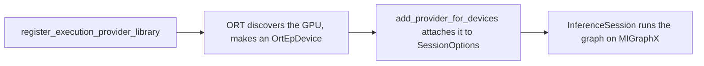

# 03. Run the model on the MIGraphX EP

Same model as lecture 02, now on the GPU. The model does not change. What changes is how you tell ONNX Runtime to use the MIGraphX plugin instead of the CPU.

## The two calls

With the CPU EP you passed a name in a list. The plugin EP cannot work that way, because ONNX Runtime does not contain it. You do two things instead.

**Register the library.** This loads `libmigraphx-ep.so` and lets ONNX Runtime discover the GPU behind it.

```python
ort.register_execution_provider_library("MIGraphXExecutionProvider", lib_path)
```

**Attach the device to the session.** Registration tells ORT the EP exists. You still have to say "use it for this session." You find the EP's device and attach it to a `SessionOptions`:

```python
dev = next(d for d in ort.get_ep_devices() if d.ep_name == "MIGraphXExecutionProvider")
so = ort.SessionOptions()
so.add_provider_for_devices([dev], {"device_id": "0"})
sess = ort.InferenceSession("tiny.onnx", so)
```

One rule to remember: every option value in that dict must be a string. `"device_id": "0"`, not `0`. The same pattern is in the model's own harness, [bench_onnx.py](../MX2/bench_onnx.py) around lines 121-137, and in the small helper [exp/_ep.py](exp/_ep.py) these experiments share.



## Experiment: run on the GPU and compare

```bash
source ep-plugin-from-source/env-learn.sh
$LPY ep-plugin-from-source/exp/run_mgx.py
```

Expected tail (ignore any `adjust_allocation` warnings, which come from MIGraphX):

```text
providers: ['MIGraphXExecutionProvider', 'CPUExecutionProvider']
y   = [[1.0, 1.0, 2.0, 4.0]] (from the MIGraphX EP)
match: True
ran on MIGraphX EP: True
```

Two things to notice. First, `providers` lists `MIGraphXExecutionProvider` first and `CPUExecutionProvider` second: ONNX Runtime keeps the CPU as a fallback for anything the GPU EP cannot take. Second, the answer is identical to the CPU run. The model ran on hardware you reached through a plugin you will soon compile yourself.

If registration fails with `libonnxruntime.so.1: cannot open shared object file`, you missed the symlink in lecture 02. If `get_ep_devices()` shows no MIGraphX device, run [exp/list_ep_devices.py](exp/list_ep_devices.py) and check the GPU-discovery warnings.

You can stop here.
