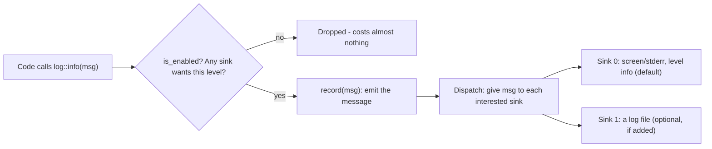

# MIGraphX Logging - Explained Simply (beginner notes)

Goal of this note: understand every word in the logging issue
([ROCm/AMDMIGraphX#5359](https://github.com/ROCm/AMDMIGraphX/issues/5359))
before touching any code. Zero prior knowledge assumed.

---

## 0. First: how to explain this issue in your meeting

Read this part only if you're short on time before the meeting.

### One sentence
> "MIGraphX prints a lot of `INFO` log messages by default, and right now there's
> no way to turn them down from **Python** - you can only do it from the
> command-line tool. The fix is to expose the existing log-level control to the
> Python API."

### 30-second version
> "MIGraphX has its own logging system (in `src/logger.cpp`). By default it prints
> everything at `INFO` level and above to the screen. The command-line
> `migraphx-driver` has a `--log-level` flag to change that, but the Python module
> (`import migraphx`) never exposed that control. So anyone using MIGraphX from
> Python - including through ONNX Runtime - gets spammed with lines like
> `[INFO] ... Skipped 1 configs for gpu::mlir_op` and can't quiet them. The C++
> function to fix this (`set_severity`) already exists and is tested; we just need
> to add a small binding so Python can call it."

### Likely follow-up questions (and short answers)
- **"Can't they just lower the ONNX Runtime log level?"**
  No. ORT's log level only hides *ORT's own* messages. These noisy lines come from
  **MIGraphX's separate internal logger**, which ORT does not control.
- **"Is there really no workaround today?"**
  On the current `develop` branch there's a numeric environment variable
  (`MIGRAPHX_LOG_LEVEL=2`) that works, but there's still nothing in the Python
  API, which is what the issue asks for.
- **"Is it a big change?"**
  No - it's labelled a *good first issue*. We add ~15 lines of Python bindings
  plus a small test. No change to the logger itself.

---

## 1. The big picture in one analogy

Think of the program as a **chef in a busy kitchen who calls things out loud** as
they work ("starting the sauce", "skipped a step", "the oven is broken!").

- Some call-outs are **emergencies** (oven on fire).
- Some are just **chit-chat** (I stirred the pot).

A **logger** is that announcement system. You can decide **how much** you want to
hear, and **where** it gets written down.

| Kitchen word | Real logging word | Plain meaning |
|---|---|---|
| The chef calling things out | **Logger** | The system a program uses to report what it's doing |
| One thing the chef says | **Log message / log record** | A single line of output, e.g. "Skipped 1 configs" |
| How urgent the call-out is | **Severity** | How important a message is (emergency vs. chit-chat) |
| The volume/importance dial | **Level** | The cutoff: how much you want to hear |
| A person writing calls into a notebook | **Sink** | A destination that catches messages and writes them somewhere |
| The exact pen-stroke they make | **Callback** | The actual action a sink runs for each message |
| Chef shouting the message to the room | **record()** | The act of emitting one message to the logger |
| Handing the message to each listener | **Dispatch** | The logger passing a message to every interested sink |
| "Is anyone even listening right now?" | **is_enabled()** | A cheap check to skip work if nobody cares |
| A translator between two languages | **pybind11** | The tool that lets Python call C++ code |

---

## 2. The words you must not be fuzzy on

### 2.1 Logger
A **logger** is just the part of a program that **reports what it is doing** as
text. Instead of the code silently running, it says things like "Compiling..."
or "Skipped 1 configs". MIGraphX's logger lives in one file:
`AMDMIGraphX/src/logger.cpp` (with its "menu of functions" in
`AMDMIGraphX/src/include/migraphx/logger.hpp`).

### 2.2 Log message (a.k.a. log record)
**One line** the program emits. Example from the issue:
```
2026-10-07 13:37:29 [INFO] [.../compile_ops.cpp:544] Skipped 1 configs for gpu::mlir_op
```
It carries three things: **when** (timestamp), **how important** (`[INFO]`),
**where in the code** (`file:line`), and the **text**.

### 2.3 Severity
**How important a message is.** "The GPU failed" is severe; "I skipped a config"
is not. Every message is tagged with one severity when it's written.

### 2.4 Severity levels (the 6 MIGraphX uses)
Think of a **verbosity dial** from silent to chatty:

| Level | Means | Example |
|---|---|---|
| `none` | say nothing | (silence) |
| `error` | only real failures | "GPU allocation failed" |
| `warn` | failures + warnings | "input has no value" |
| `info` | + general progress **(this is the default)** | "Skipped 1 configs", "Compiling..." |
| `debug` | + extra detail for developers | internal step info |
| `trace` | + everything, very noisy | every tiny action |

Key idea: **each level includes everything above it.** If you set the dial to
`warn`, you hear `error` and `warn`, but **not** `info`. That is exactly how you
kill the spam in the issue: turn the dial from `info` down to `warn`.

> In code these are an **enum** (see 2.12). Internally `none=0, error=1, warn=2,
> info=3, debug=4, trace=5`; a sink shows a message when the message's number is
> `<=` the sink's level number.

### 2.5 Sink
A **sink** is a **destination** for messages - something that catches each
message and writes it somewhere. "Sink" is a common programming word for "the
place data flows into" (like a kitchen sink is where water goes).

MIGraphX can have several sinks at once. By default there is **one** sink:
- **Sink 0** - writes to the **screen** (specifically `stderr`, see 2.11), at the
  `info` level.

You can add more sinks, e.g. a **file** sink that also writes messages to a
`.log` file. Each sink is stored as a small pair: `{callback, level}`.

### 2.6 Callback
A **callback** is **a function you hand to someone else so they can call it
later.** You don't call it yourself; the logger calls it for you whenever a
message needs to be written.

For a sink, the callback is *the action that actually writes the message* - e.g.
"print this text to the screen" or "append this text to the file". So a sink =
**what to do with a message** (the callback) + **when to bother** (the level).

### 2.7 Level (of a sink)
Each sink has its **own** dial. Sink 0 (screen) might be at `warn` while a file
sink is at `debug`. A message goes to a sink only if the message's severity is
important enough for *that* sink's level. This is why you can show little on
screen but save everything to a file.

### 2.8 record()
The function the program calls to **emit one message**:
`record(severity, text)`. In the kitchen analogy, this is the chef **actually
shouting** the sentence. Everything in section 2.4-2.7 happens *inside* `record`:
it looks at all sinks and gives the message to the ones that care.

### 2.9 Dispatch
**Dispatch** just means **"hand this out to each recipient."** When `record` runs,
it **dispatches** the message to every sink whose level is high enough. (One
message can go to the screen *and* a file at the same time.) It's not a special
MIGraphX word - it's general programming vocabulary for "route/deliver to the
right handlers."

### 2.10 is_enabled()
A **fast yes/no check**: "would *any* sink actually record a message at this
level right now?" If the answer is no, the program skips building the message at
all. This matters because building a message (gluing text and numbers together)
costs time; `is_enabled` lets disabled logging cost **almost nothing**.

### 2.11 `log::info()`, `log::debug()`, etc. (what those calls in the code mean)
These are **shortcut helpers** so programmers don't type `record(severity::info,
...)` every time. You will see them all over the codebase:

```cpp
log::info()  << "Skipped " << skipped << " configs";   // severity = info
log::warn()  << "Input without a value";               // severity = warn
log::error() << "GPU allocation failed";               // severity = error
log::debug() << "internal detail";                     // severity = debug
```

Read `log::info() << "..."` as: *"announce this sentence at `info` importance."*
Under the hood it checks `is_enabled`, builds the text, and calls `record`.
`log::` is just the **namespace** (a labelled folder for related functions) these
live in. The noisy line in the issue is a `log::info()` call in
`src/targets/gpu/compile_ops.cpp`.

### 2.12 enum
An **enum** ("enumeration") is a **fixed list of named choices**. Instead of
remembering that "3 means info", you write `severity::info`. MIGraphX's levels
(`none/error/warn/info/debug/trace`) are an enum. It's just a tidy, mistake-proof
way to represent "one of these specific options."

### 2.13 Environment variable
A setting you give a program **from outside**, in the terminal, before it runs -
e.g. `MIGRAPHX_LOG_LEVEL=2`. The program reads it at startup. It's a way to
change behavior without editing or recompiling code. (This already works for the
log level on `develop`, but only with numbers.)

### 2.14 stderr vs stdout
Two **output channels** every program has:
- **stdout** = "standard output" = normal results.
- **stderr** = "standard error" = messages/diagnostics.

By default both show up on your screen together. MIGraphX's default log sink
writes to **stderr**. (That's why the logs appear even when you only expected
your program's normal output.)

### 2.15 pybind11
MIGraphX's core is written in **C++** (fast, compiled). Many users drive it from
**Python** (easy to use). **pybind11** is a library that acts as a **translator**:
it lets you take a C++ function and make it callable from Python. The file
`AMDMIGraphX/src/py/migraphx_py.cpp` uses pybind11 to expose C++ features (shapes,
programs, etc.) to Python.

### 2.16 "The Python API"
The **set of commands you get after `import migraphx`** in Python. Each command
there exists because someone bound a C++ function with pybind11. **The whole
issue is that the logging functions were never bound** - so they're missing from
`import migraphx`.

---

## 3. How a single log line travels (picture it)



---

## 4. How this connects to the issue and the fix

- The noisy `[INFO] ... Skipped N configs` lines are `log::info()` calls inside
  MIGraphX. They show because **sink 0's level is `info` by default**.
- From the **command line**, `migraphx-driver --log-level warn` turns the dial
  down - that calls the C++ function `set_severity(warn)`.
- From **Python**, there is **no equivalent** - `set_severity` was never bound
  with pybind11. That's the gap.
- **The fix:** bind the level enum and `set_severity` into
  `migraphx_py.cpp` so Python users can write:

```python
import migraphx
migraphx.set_log_level(migraphx.log_level.warn)  # silences the INFO spam
```

That's the whole plan (plus a small test). No change to the logger's internals.

---

## 5. Check-your-understanding (answer in your own words)

1. What is the difference between a **severity** (on a message) and a **level**
   (on a sink)?
2. If sink 0 is set to `warn`, will a `log::info()` message appear on screen? Why?
3. In one sentence, what does a **sink's callback** do?
4. Why does the ONNX Runtime log-level setting *not* silence these messages?
5. What does **pybind11** have to do with this issue?

> Deliverable done when: you can give the 30-second meeting explanation from
> memory, and define logger, severity, level, sink, callback, record, dispatch,
> and pybind11 without looking.
